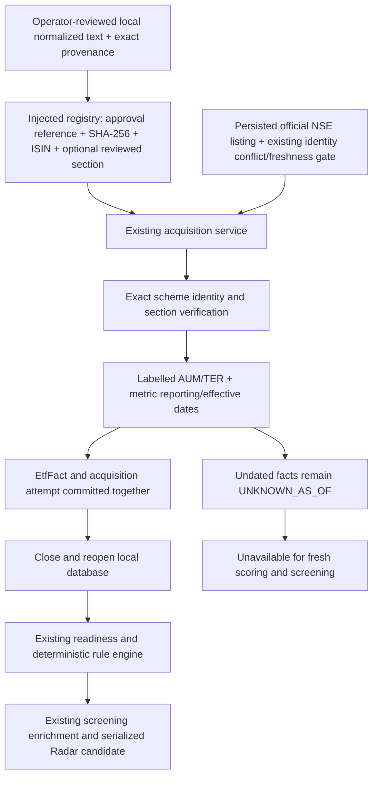

# ETF AUM/TER ingestion correction — offline review, 2026-10-28

Local fixture correctness: **GO for the supported, explicitly authorized text contract**.
Real AMC ingestion/deployment: **NO-GO**. No genuine AMC factsheet was available in the
searched local repository/fixture/document locations. The required genuine wrong-ETF
document negative test could not be performed. Synthetic fixtures do not establish
real provider correctness, PDF extraction correctness, or production readiness.

No internet/provider calls, ETF scans, production database operations, deployments,
container/image operations, environment changes, or scheduler activation were performed.
The reported 358/344/1/332 universe counts were supplied context, not revalidated here.
The checkout already contained extensive unrelated work; only the files listed below
were edited for this task. No commit was made.

## Independent review of the starting checkout

References in this table identify the **pre-edit functions**, not assertions about the
corrected implementation. The requested `tests/test_etf_aum_ter_pre_deployment.py` did
not exist. The actual file was `tests/test_etf_pre_deployment_correctness.py`.

| Suspected defect | Classification | Verified behavior / references |
| --- | --- | --- |
| Caller-supplied UUID supplies scheme identity | CONFIRMED | `etf_acquisition.EtfAcquisitionService.acquire_official_document` checked document/profile UUID, hostname, classification, status, reliability and mode, but never matched an independently verified ISIN or the fund named in the content. |
| Acquired AUM/TER have no reporting date | CONFIRMED | That function constructed `EtfFact` without `as_of_date`, including when the input explicitly stated a metric date. |
| Registered reporting date is dropped | CONFIRMED | `VerifiedDocumentSource.as_of_date` existed, but `ingest_all_registered_documents` did not pass it onward; `ingest_etf_facts_from_document` had no corresponding date parameter. |
| UNKNOWN_AS_OF cannot score | CONFIRMED, intentional protection | `etf_evidence.etf_freshness` returns UNKNOWN_AS_OF; `etf_readiness._check_supporting_ready` returns MISSING; `etf_rule_engine._fresh_fact` and `etf_screening.screening_evidence` exclude it. These behaviors were preserved. |
| Global registry has lifecycle/authorization limits | CONFIRMED | `_document_registry` was a mutable process singleton with no durable initialization, maximum size, approval binding, or expiry/revocation contract. Direct `ingest_etf_facts_from_document` bypassed registration altogether. |
| Tests cover only persistence, never cycle serialization | NOT CONFIRMED as worded | `test_full_flow_through_radar_cycle` did call the cycle and serializer. However, it accepted either EVALUATED or INSUFFICIENT_DATA, and did not establish scored cost, AUM risk input, fresh screening metrics and reopened-database durability in one path. Several tests explicitly asserted the broken undated behavior. |
| Production document fetching/onboarding is connected | CONFIRMED missing connection | Calls to official document acquisition/registry ingestion were confined to this internal module and tests. `etf_ingestion.ingest_quotes`, `etf_full_universe.run_full_etf_cycle` and the Radar worker do not onboard AMC documents. The existing HTTP ingestion routes handle quotes/history, not these documents. |

Additional independently reproduced defects: INR amount regexes were not bound to an
AUM label, so unrelated monetary amounts and `-INR 10 crore` could become positive
AUM. Invalid comma grouping was silently stripped. TER greater than 100% was accepted.
Original/canonical URL and source-type consistency were not checked. The registry
wrapper ignored its authority argument, used a placeholder content hash, and returned
the highest-precedence stored fact instead of the fact produced by the current attempt.

## Files changed

All Python paths below are relative to `ai/research-engine/`.

| File | Purpose |
| --- | --- |
| `app/etf_acquisition.py` | Inject document registry; delegate verification/parsing; persist real metric dates and auditable provenance through existing `_record`/`save_etf_acquisition`; reject conflicting same-period primary-source input. Existing NSE and secondary quote changes were preserved. |
| `app/etf_document_parser.py` (new) | Verify scheme against persisted official listing and existing identity gate; validate exact approved text/provenance/section; parse bounded, labelled values and metric dates conservatively. |
| `app/etf_document_discovery.py` | Replace the global registry and self-authorizing wrapper with caller-owned approvals, five-document and size limits, content binding, truthful batch outcomes, and per-attempt result lookup. This remains an internal local-text API. |
| `tests/test_etf_document_trust.py` (new) | Identity, content binding, provenance, authorization, section isolation and initial fail-before regressions. |
| `tests/test_etf_aum_ter_acquisition.py` | Replace redundant/undated happy paths with explicitly authorized numeric, currency, reporting-date and freshness cases. |
| `tests/test_etf_pre_deployment_correctness.py` | Replace weak global-registry and cycle assertions with isolated authorization, verified date propagation and an actual async Radar serialization round trip. Retain unknown-date unavailability coverage. |
| `tests/test_etf_acquisition_persistence.py` | Supply independent listing/ISIN and approved content to the existing document parser tests. Keep their value/unit/outcome assertions. |
| `docs/ETF_AUM_TER_INGESTION_REVIEW.md` | This review, limits and bounded next validation plan. |

No changes were made to readiness, scoring thresholds, screening, cycle dispatch,
full-universe execution, persistence schema, HTTP routes, runtime settings or deployment files.

## Corrected data flow



The test calls `run_etf_radar_cycle_async` with one local synthetic candidate and an
injected test clock. It exercises the real evaluate → serialize → screening enrichment
→ save path. The saved payload is read after another database reopen. No provider,
canonical-service transport, historical top-up, or full-universe path is invoked.

## Supported contract and preserved protections

- Every document needs an explicit internal approval reference, exact UTF-8 normalized
  text SHA-256, source metadata, actual retrieval timestamp and scheme ISIN. A caller UUID or hostname alone cannot
  pass. The registry must be injected; there is no implicit singleton/default approval.
- Independently stored official NSE listing evidence must match profile ISIN/symbol.
  Existing NSE identity conflict and identity freshness checks run first. Missing,
  secondary, conflicting or stale canonical evidence cannot authorize a document.
- The approved section must contain one explicit `ISIN: ...` line and one matching
  scheme name/header. Conflicting ISINs, scheme headers or explicit symbols are rejected.
  A multi-scheme document requires reviewed complete-line character bounds tied to the
  full content hash; only that section supplies metrics. Ambiguous whole-document
  extraction is rejected. An ISIN-free authoritative mapping fallback is **disabled**.
- REAL/PROCESSED status, exact trusted hostname, LEVEL_A/B reliability, source type,
  source classification, authority and original/canonical URL consistency are enforced.
  URLs are metadata only. HTTPS is required; credentials, IP literals, custom ports,
  query strings, fragments and differing original/canonical URLs are rejected. No
  redirects, fetching, scraping or upload endpoint were added.
- One internal call handles one approved document and two metric attempts; a registry
  holds at most five documents. Each text is at most 1,000,000 characters. Parsing rejects
  lines above 4,096 characters and numbers above 24 digits to bound work and avoid
  implicit Decimal precision loss. Registry entries are frozen; section bounds are tuples.
- Supported amounts require explicit AUM/assets-under-management/fund-size labels,
  explicit currency and crore/lakh/million/billion scales. Valid Indian and international
  comma groups are supported; decimal commas, negative/parenthesized/range/approximate
  values and incompatible currency/scale combinations are rejected. INR conversion is
  exact, and EUR/USD/GBP are preserved without conversion. Non-INR AUM stays unavailable
  to the INR-specific screening filter and low-AUM gate.
- TER remains percentage points (`0.35%` → `Decimal('0.35')`, unit `percent`). Only the
  mathematical 0–100 percent range is admitted; zero and 5% remain valid inputs. Cost
  breakpoints and other investment thresholds are unchanged.
- Dates must be ISO dates explicitly tied to the metric: e.g. a value followed by
  `(as of YYYY-MM-DD)` / `(effective YYYY-MM-DD)`, or an `AUM reporting date:` /
  `TER effective date:` line. A shared `VerifiedDocumentSource.as_of_date` is honored
  only when corroborated by an exact `AUM and TER as of YYYY-MM-DD` statement in the
  approved section. Shared and per-metric dates cannot conflict. Publication, retrieval
  and upload timestamps never fill metric dates. Future metric dates, including dates
  later than document retrieval, are rejected. Existing AUM 35-day and TER 90-day
  freshness windows remain intact; stale and unknown-date facts do not score fresh.
  Pre-fetched documents retain their approved retrieval timestamp; the ingestion clock
  is used for acquisition attempts and freshness evaluation, not source retrieval time.
- Conflicting values/dates within a section are rejected. Incoming primary-source
  values that contradict an already accepted value for the same metric/period are
  rejected; the previously accepted fact is retained. This is **not** an automatic
  correction/adjudication workflow or a quarantine of all previously persisted data.
  Existing historical conflicts need separate review before production use.
- Stable source hash/URL, approved section, metric line locators, reporting date,
  approval reference and listing evidence IDs survive persistence. Repeating the same
  approved source produces the same evidence ID. The original artifact and normalized
  text must be retained by the operator/source archive; this module does not implement
  a durable document archive.

## Test evidence

Starting checkout: `test_etf_aum_ter_acquisition.py`,
`test_etf_pre_deployment_correctness.py`, and `test_etf_acquisition_persistence.py`
reported **164 passed** in 153.48s. That result alone did not demonstrate correctness.

Before implementation, the new initial 14-case trust regression set produced
**13 failed, 1 passed**. The failures reproduced four scheme-identity errors, two
provenance inconsistencies, four unsafe numeric cases, two lost metric dates and one
accepted future metric date. The passing control proved publication time did not fill
an unknown metric date. After adding the approval fixture prerequisites, the same
behavior assertions passed. No identity threshold or scoring threshold was reduced.

An isolated test process also loaded the committed pre-change
`acquire_official_document` method using `git show HEAD:...` and substituted **only
that method in memory**. The current wrapper and fixtures were retained. Five selected
cases failed: missing registry authorization, content tampering, shared registered
reporting date, and both durable candidate cases (missing new scheme provenance).
This was a targeted method comparison, not a reproduction of the entire old checkout
or old global-registry implementation. The bounded registry lifecycle tests cover a
new contract; there is no claim that these exact new-signature tests ran on the old API.

Current focused runs:

```powershell
# From C:\workspace\ai-investment-platform\ai\research-engine
python -m pytest -q tests/test_etf_document_trust.py tests/test_etf_aum_ter_acquisition.py tests/test_etf_pre_deployment_correctness.py --tb=short
# 114 passed in 4.35s

python -m pytest -q tests/test_etf_acquisition_persistence.py tests/test_etf_readiness.py tests/test_etf_rule_engine.py --tb=short
# 139 passed in 100.33s
```

The 26 document/numeric cases in `test_etf_acquisition_persistence.py` were additionally
rerun after the final parser/approval changes (the other 61 cases were deselected).
These are a subset of the 139, not additional unique tests. Total distinct focused
passing cases across the two suites: **253**.

The ingestion suites verify wrong fund on the same **synthetic** AMC domain, wrong or
missing ISIN, canonical/profile mismatches, multi-scheme isolation, existing identity
conflicts, authorization isolation, tampering/provenance, numeric scales, currency,
date conflicts, future/stale/unknown dates, repeat ingestion and attempted conflicting
revisions. Positive durable candidate assertions include READY_FRESH AUM/TER, cost
score 79 for the synthetic 0.35% TER, the existing low-AUM gate for synthetic INR 5 crore,
and valid serialized AUM/TER screening values. The undated variant asserts MISSING /
UNKNOWN_AS_OF, unavailable cost/screening and no fresh low-AUM gate.

One intermediate new-test run had 98 passes and two setup errors because its socket
guard blocked Windows asyncio's internal socketpair. The guard was corrected to block
HTTP transports/DNS/provider connection creation, and both cases passed afterward.
No unrelated pre-existing test failures occurred in the focused runs. The broader
repository suite, PostgreSQL, live providers and deployments were not tested.

## Remaining dependencies and next bounded validation

1. Obtain and archive one genuine official AMC factsheet and a genuine different-ETF
   factsheet from the same AMC, with source/redirect history and original byte hashes.
   This must be a separately authorized operation. The wrong-ETF negative case is an
   explicit unmet requirement here; no synthetic document is represented as genuine.
2. Verify canonical UUID/ISIN/symbol against official listing evidence and trusted
   instrument master data. Review AMC domain ownership and the exact document identity.
   Supply the real files as offline fixtures first. Do not rewrite their text into the
   parser's grammar or invent identity/date markers to make them pass.
3. Validate extraction and metric section/date locators against the actual PDF. The
   current parser deliberately supports only a narrow labelled text layout and ISO
   dates. Unsupported real layouts stay rejected until a fixture-backed adapter exists.
4. Retain original and normalized artifacts, hash-bound approvals and reviewer identity
   in a durable operator-controlled archive/configuration. Establish authenticated
   operator access, explicit authorization and revocation before exposing any service
   entry point. Never construct approvals from upload/request parameters. No production
   registry loader, fetcher or authenticated onboarding route exists in this correction.
5. Re-run the focused tests and the two genuine artifact cases in an isolated database.
   Verify values, currency, independent AUM/TER dates, evidence IDs and serialized
   candidate fields after close/reopen. Audit existing evidence/conflicts separately.
6. Only after those gates pass, prepare a deployment of the reviewed backend changes
   using the established deployment process, with automatic acquisition and schedules
   disabled. Validate one explicit canonical ETF and one approved document through the
   bounded internal path; inspect acquisition attempts and persisted candidate output.
   Reject any identity, provenance, date or numeric mismatch and stop that operation.

This change does not acquire benchmark, holdings or tracking metrics and does not
establish a ranking improvement across the NSE universe. Their absence is separate
from the corrected AUM/TER trust and date pipeline.
